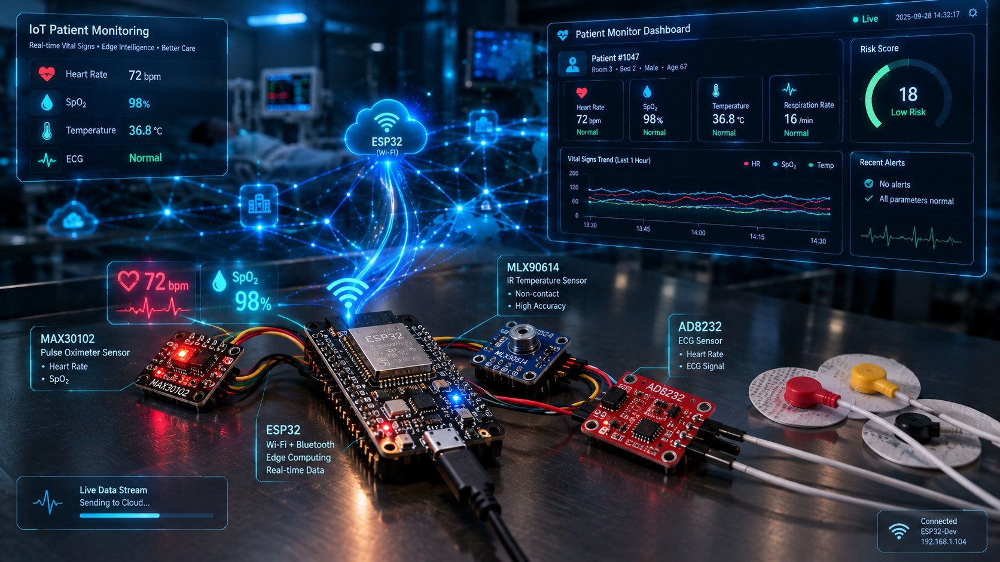
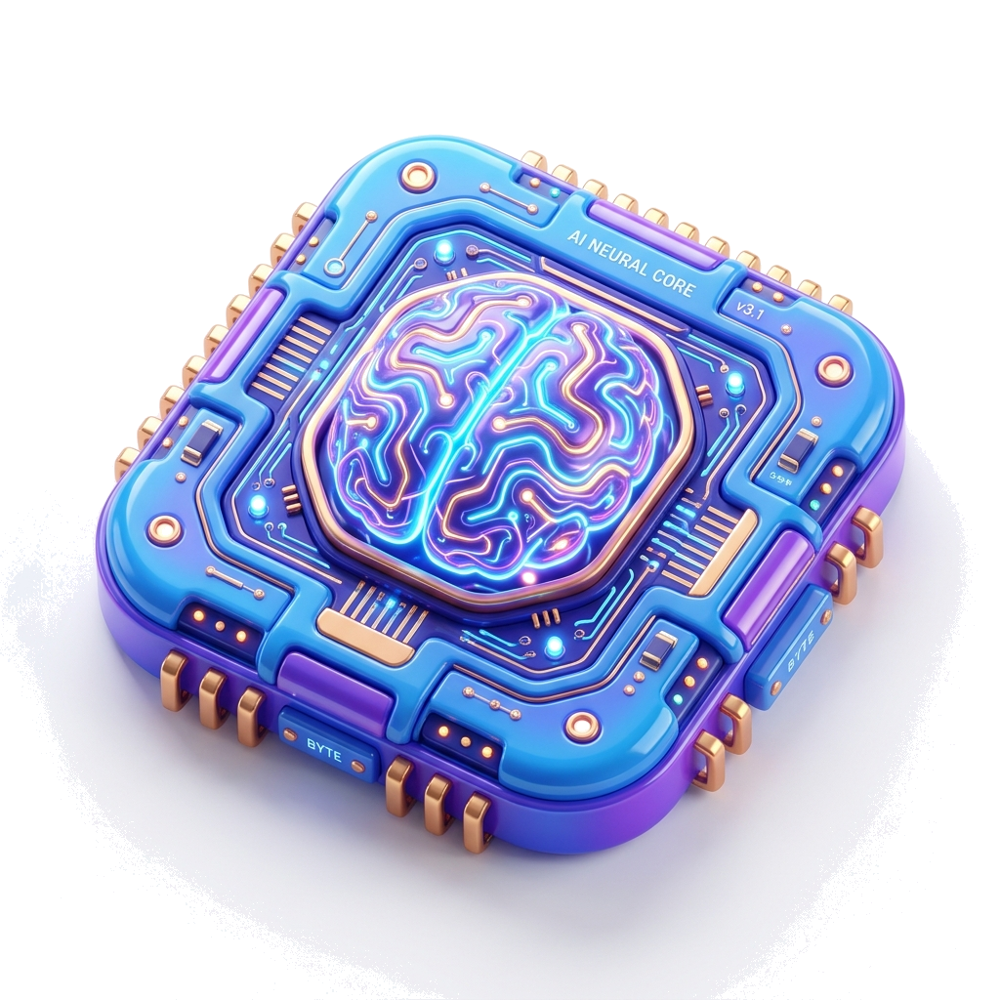
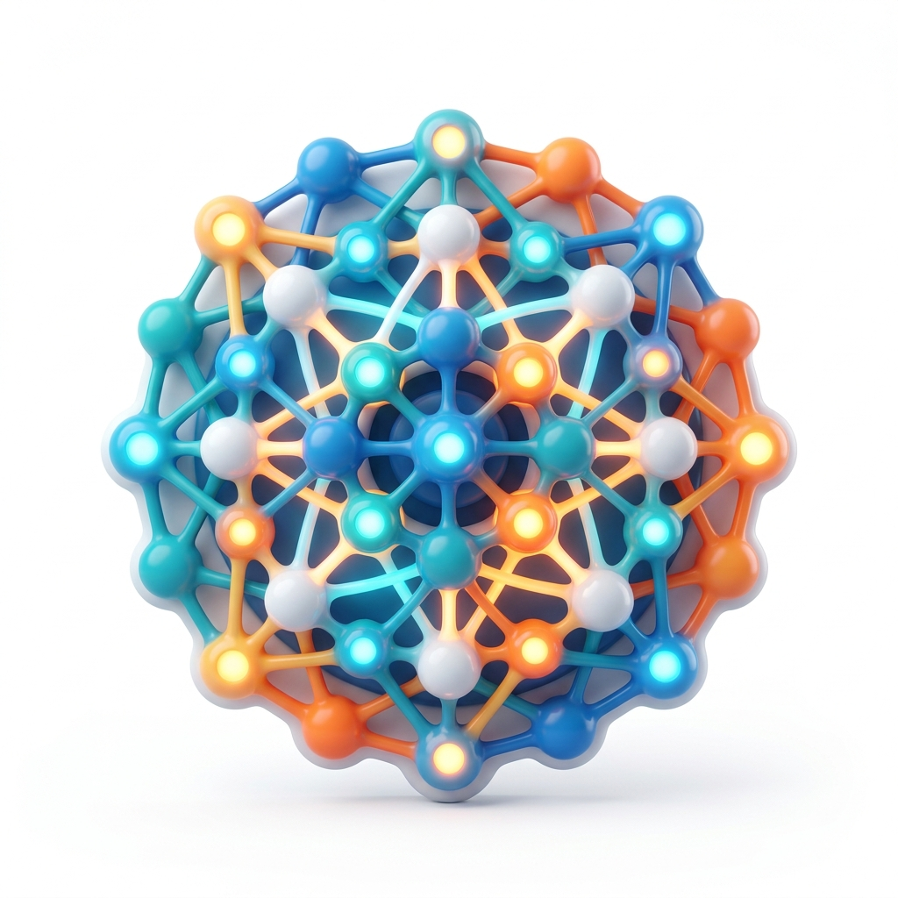
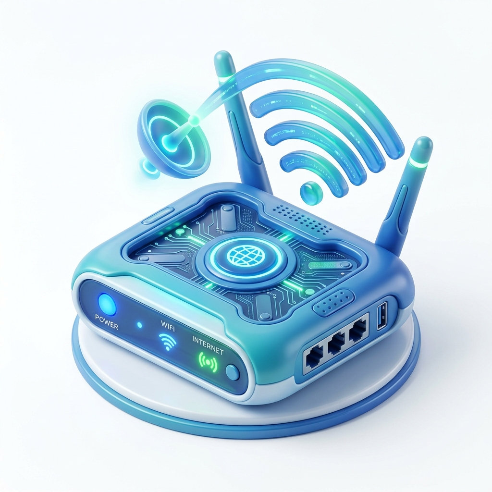
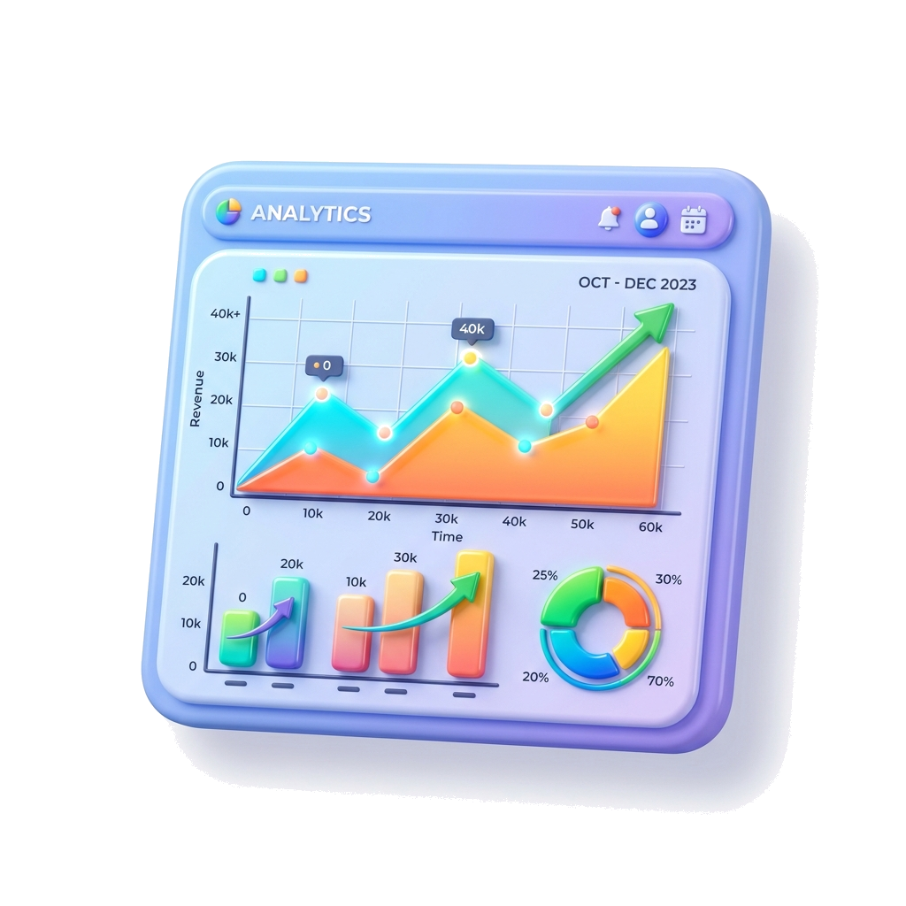

<div align="center">

# Resilient Edge-Intelligence Patient Monitoring Mesh
**Academic major project — MedTech + IoT + Computer Networking**



*A real-time, multi-patient monitoring prototype in which patient sensor nodes collect vital signs, perform local risk analysis, and reliably deliver prioritized health telemetry through a resilient local mesh network.*

[](#-current-status)
[](.github/LICENSE)
[](https://github.com/SyedAynan/Patient-monitoring-mesh/actions/workflows/ci.yml)
[](.github/CONTRIBUTING.md)

</div>

> **⚠️ Disclaimer:** This is an educational/research prototype. It is not a certified medical device and does not replace clinical judgment.

##  Table of Contents
- [ Core Features](#-core-features)
- [ Documentation](#-documentation)
- [ Current Status](#-current-status)
- [ Setup & Development](#️-setup--development)
- [ Contributing](#-contributing)
- [ License](#-license)

##  Core Features

-  **Multi-node sensing:** ESP32-based nodes with vital sensing (heart rate/SpO2, temperature).
-  **Local processing:** Filtering, signal-quality indicators, trend/risk scoring, and local critical-event detection.
-  **Resilient local networking:** Local multi-hop network with prioritized packets, acknowledgements, and retry handling.
-  **Gateway ingestion:** Gateway node forwarding normalized telemetry to the backend.
-  **Real-time dashboard:** Live patient cards, vital trends, risk state, and active alerts.
-  **Store-and-forward:** Nodes buffer data during temporary disconnections to guarantee delivery upon reconnection.

##  Documentation

Detailed documentation is stored in the `/docs` directory. Read through them to understand the system design:

-  **[PRD (Product Requirements Document)](docs/PRD.md)** - Project vision, user goals, and functional requirements.
- 🏗️ **[Architecture](docs/Architecture.md)** - High-level system design, edge-node architecture, and gateway details.
- 📐 **[Design](docs/Design.md)** - Component-level designs and implementation details.
- 🛤️ **[Phases (Delivery Plan)](docs/Phases.md)** - Step-by-step roadmap for project delivery.
- 📏 **[Evaluation (Measurement Method)](docs/Evaluation.md)** - Metrics, experiment scenarios, and evidence rules. No results measured yet.
- ⚠️ **[Risks (Risk Register)](docs/Risks.md)** - Hardware, protocol, security, and process risks with fallbacks.
- 📜 **[Rules (Engineering Rules)](docs/Rules.md)** - Coding style, project constraints, and architectural guidelines.

##  Current Status

### Progress: Phase 3 Complete (of 8)
Three phases are done, verified by 105 passing tests:

- **Phase 1 (Foundation) — complete:** versioned packet schema, authoritative
  validator with stable error codes, language-neutral conformance fixtures, and a
  feasibility spike.
- **Phase 2 (Sensing & simulated pipeline) — complete:** simulated patient nodes,
  a relay, and a gateway running over an abstract transport, with deterministic
  loss, duplication, corruption, reordering, and reconnect handling.
- **Phase 3 (Local transport & prioritized delivery) — complete:** bounded
  critical-first priority queues, an acknowledgement frame the relay returns to
  senders, and bounded retries that measurably raise delivery under loss.

**Not yet built** — do not mistake the simulator for these:

- **Phase 4 (store-and-forward, resilient routing):** the transmit queue is
  bounded, but there is no durable buffering or backfill, and there is one relay
  hop with no alternate path, so relay loss is still a full outage. Nothing here
  is a "self-healing mesh", and the project will not claim that until Phase 4
  measures it.
- **Phases 5–8:** no backend, database, dashboard, risk scoring, or security work
  has started.

> **⚠️ Physical ESP32 / ESP-NOW validation: DEFERRED until hardware is available.**
> No board has been flashed and no radio has been tested. `simulator/transport/espnow.py`
> raises `NotImplementedError` and `is_available()` returns `False`. Every result in
> this repository comes from a simulated link on a single clock and is **not** a
> measured network result.

##  Setup & Development

Our current stack relies heavily on the Python standard library for simulation and protocol validation. To get started and run the existing components:

```bash
# Run basic mesh and packet demonstrations
python tools/packet_demo.py
python tools/mesh_demo.py
python tools/generate_fixtures.py

# Run the test suite
python -m unittest discover -s tests -p "test_*.py" -v
```

**Simulator architecture.** The `simulator/` directory is the stand-in for physical
ESP32 nodes, and it is layered so a real radio can replace the simulated one:

```text
simulator/
  transport/    Transport protocol, Frame envelope, SimulatedMedium, espnow.py (unimplemented)
  sensing/      VitalSource implementations, SignalFilter, plausibility checks
  roles/        SensorNode, RelayNode, Gateway  -- depend on Transport, not on the medium
  topology.py   builds node -> relay -> gateway
```

Roles import only the `Transport` protocol and `Frame`, never `SimulatedMedium`.
That is what makes `EspNowTransport` a drop-in replacement for the link rather than
a rewrite of the application layer. `tests/test_simulated_pipeline.py` asserts
this separation, so it cannot quietly erode.

**Protocol Conformance:**
`shared/protocol/fixtures/` contains the language-neutral conformance corpus. Any new implementation (C++ firmware, Node backend) must accept valid fixtures byte-for-byte and reject invalid ones with matching error codes.

##  Contributing

Contributions make the open source community such an amazing place to learn, inspire, and create. Any contributions you make are **greatly appreciated**.

Please see our [CONTRIBUTING.md](.github/CONTRIBUTING.md) for guidelines on how to get started, and our [CODE_OF_CONDUCT.md](.github/CODE_OF_CONDUCT.md) for community rules.

##  License

Distributed under the MIT License. See `.github/LICENSE` for more information.
